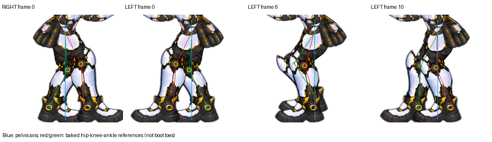

# 좌우 보행 자세 점검

2026-10-12, 수정 없이 현재 좌우 씬의 수평 조준20프레임씩을 카메라 캡처해 비교했다. 전체20쌍 모두 반전 비교에서 RGB차8 초과 픽셀0. 왼쪽에서만 발 궤적이 추가로 이동하거나 늘어나는 현상은 확인하지 못했다. 검사 후 원래 표시 자세와 왼쪽 방향을 복구했다.

## 좌표 근거와 한계

baked-walk-v32.json 기준 골반 시작점 near x253 / far x251. near 발목은 골반 대비 -56~+44px, 평균-6px. far 발목은 -54~+46px, 평균-4px. 두 발목 중점의 골반 대비 위치는 -15.35~+5.35px. 따라서 발목 궤적 전체가 앞쪽으로 이동했다는 해석은 지지하지 않는다.

무릎은 near x255.07~306.07, 평균280.17(골반보다 약27.17px 앞), far x256.04~307.40, 평균281.58(약30.58px 앞). 현재 베이크는 모든 자세에서 무릎이 앞으로 굽는 같은 IK 분기를 사용한다. 이 자체가 보행 오류라는 뜻은 아니지만, 전 주기에서 굽힌 자세가 강하게 남아 보이는 점검 대상이다.

수치는 원본 베이크 관절 기준이다. 최신v72에는 픽셀 윤곽 수정, 3px 골반 표시 변형, 신발 오프셋이 있으므로 현재 부츠 실루엣의 무게중심을 직접 측정한 값은 아니다. v32 부츠 피벗에는 발목 목표보다 +10px 오프셋이 있고, v56 이후 far 부츠는 +2px다. 종아리 연결을 맞춘 과거 조정이므로 이를 즉시 없애면 연결이 다시 깨질 수 있다. 큰 앞코도 발 전체가 앞쪽으로 쏠려 보이는 인상에 기여할 수 있다.

현재 처음 표시되는0번과 정지 전환의0/10번은 양발이 착지한 보행 자세다. 두 발목 수평 간격83.33px로, 별도 자연스러운 서기 자세가 아니다. 정지에서 위화감을 주는 근거가 가장 명확한 부분이다.

## 판단

반전 기능은 유지한다. 앞선 사진 설명에서 말한 '발 전체가 앞으로 나왔다'는 시각적 인상과 실제 발목 궤적의 중심은 구분한다. 정지 자세부터 따로 만들고, 그 후 보행의 무릎 굽힘/다리 길이/부츠 연결을 함께 검토하는 순서가 적절하다. 발 전체나 하체를 뒤로 통째로 옮기는 수정은 이번 근거로 권하지 않는다. 이번에는 코드/아트/보행 좌표를 바꾸지 않았다.

