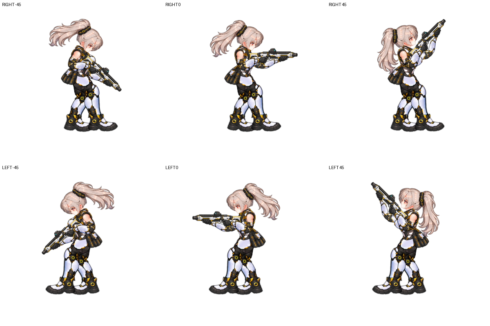

# 오른쪽 걷기·조준 캐릭터 인계 — 2026-10-11

## 다음 대화에서 먼저 읽을 내용

이 문서는 집 PC에서 작업한 결과를 학원 노트북의 Codex에 이어주기 위한 인계다. 한국어로 답변한다. 현재 기준은 오른쪽 걷기 20프레임과 ±45도 조준, 귀 아래 경계까지 옷깃 뒤로 가리는 처리가 적용된 상태다. 사용자가 마지막 결과를 보고 “응 이제 자연스러워진 것 같아”라고 승인했다. 이 승인 상태부터 이어간다.

다음 과제는 **몸통–골반–양쪽 허벅지의 연결 검토**다. 검토만 했고 아직 수정하지 않았다. 사용자가 정리를 요청했으므로 인계 직후 자동으로 골반을 수정하지 말고, 아래 관찰과 실제 씬을 확인하고 이어갈 범위를 설명한다.

## 재개 방법

1. Unity 6000.3.18f1 프로젝트에 최신 `RightWalkSheet.unitypackage`를 가져온다. 기존 학원 프로젝트의 변경분은 먼저 보존하고 가져오기 목록을 확인한다.
2. `Assets/RightWalkPrototype/RightWalkSheetDemo.unity`를 열고 Play한다.
3. 기본은 제자리 걷기. Mouse aim 체크로 오른쪽 기준 -45도~+45도를 확인한다. 이동은 WASD/방향키. 하체 20프레임, 이동 속도 .8, cycleDistance 약 .8138이다.
4. 이 문서와 `Reference-Images`의 마지막 승인 모습 및 골반 검토 그림을 읽는다.
5. 옛 README의 v34/±12도 설명은 과거 기록이다. 현재 상태는 이 문서와 실제 Builder/스크립트가 기준이다.

프로젝트의 메인 게임 전체에 통합한 결과가 아니라 `Assets/RightWalkPrototype` 아래 독립 시제품이다. 8방향 전체, 사격/충돌/네트워크 통합은 이 작업에서 완료하지 않았다.

## 현재 파일과 구조

| 항목 | 기준 |
|---|---|
| 씬 | `Assets/RightWalkPrototype/RightWalkSheetDemo.unity` |
| 프리팹 | `Assets/RightWalkPrototype/RightWalkSheetWalker.prefab` |
| 재구성 | `Editor/RightWalkSheetBuilder.cs`의 `RightWalkSheetBuilder.Build()` |
| 걷기 | `Scripts/RightFacingWalker.cs` |
| 골반 높이 추종 | `Scripts/RightFacingHipLink.cs` |
| 조준/머리·목 | `Scripts/RightFacingAimRig.cs` |
| 양팔 IK | `Scripts/RightFacingArmIK.cs` |
| 목 피부 연결 면 | `Scripts/RightFacingNeckSkin.cs` |
| 머리 분리 표시 | `Art/HeadSplit-v88.shader`, `RightWalk-HeadFront-v88.mat`, `RightWalk-HeadRear-v88.mat` |
| 하체 | `Art/RightWalkSheet-Legs-FinalContour-v72.png`, 대응 Frames asset |
| 하체 테두리 | `Art/LegEdge-v42.shader`, `LegEdge-v42.mat` |
| 원본 머리 | `Art/RightWalk-HeadFace-v46.png/.asset` — 원본 픽셀 유지 |

Builder는 Play 중이거나 현재 씬이 dirty이면 실행을 거부한다. 새 씬을 생성하는 도구이므로 다른 사용자 씬을 열고 무심코 실행하지 않는다. 저장된 시제품 씬에서 실행하고, 검토용 임시 자세·카메라를 되돌린다.

### 주요 위치와 회전 값

- PPU 204.8, 원본 파츠 512×512. Pixel(x,y)=(x-256,499.2-y)/204.8.
- Upper Body Alignment: 골반 루트에서 x +10px.
- 골반 루트: 프레임별 y -(1+cos(4π×frame/20))/204.8, 즉 0~2px 상하 움직임.
- Aim Rig pivot: 원본 좌표 (255,175). 총·손은 한 파츠이며 pivot 기준 (-15,-24)px 추가 위치 보정.
- Neck Base: (252,145) + (-8,-4)px. Head pivot: (249,132).
- maxAngle 45. 목 추종 .2, 머리 위 추종 .9, 아래 추종 .45. 전체 머리 회전은 위 최대40.5도, 아래 최대20.25도.
- 숙일 때 머리 y 보정 최대 +2.5px가 남아 있다. -30도에서 최대값, -45도에서도 동일. 이번 인계에서 제거하거나 추가하지 않았다.
- 팔은 각각 상완/전완 IK, 손은 총 파츠에 포함. Near root (-7,-4)px, Far root (+3,-3)px.
- 실행 순서 HipLink 90 → AimRig 100 → ArmIK 110.

### 겹침 순서

Pelvis Underlay 8, Far UpperArm 8, 목 피부 9, 하체 10, Hip Clothing 11, Rear Hair 11, Torso 12, Collar Front 16, 총·손 17, Near Arm 18, Head and Front Hair 19. Far Forearm은 11.

뒤쪽 상완 원화에 옷깃 일부가 남아 있다. Far UpperArm을 8로 낮춰 목 피부 뒤에 가렸다. 이 파츠를 다시 앞으로 올리면 숙일 때 밝은 옷깃 조각이 나타날 수 있다.

## 사용자가 승인한 마지막 목·머리 수정

원본 머리 이미지 하나를 재생성하지 않고 두 SpriteRenderer가 같은 텍스처를 사용한다. `HeadSplit-v88.shader`가 서로 보완되는 픽셀 영역을 나눈다. 앞머리와 귀 대부분은 앞 레이어, 아래 뒷머리 및 귀 아래와 이어진 피부는 뒤 레이어다. 두 Renderer는 동일한 Head pivot 아래에서 똑같이 움직인다.

최종 분리식: y>=108이고 x<boundary인 부분이 뒤 레이어. boundary는 y111~128에서 x242~245, y>123에서는 y123~133에 따라 x244.12~261로 이어진다. 귀 아래 경계까지 옷깃 뒤로 가리는 마지막 변경이 적용되어 있다. 귀/살을 실제 삭제하는 방식이 아니라 옷깃과 겹칠 때 뒤에서 가려지게 한 것이다.

처음 분리 시(-45,-30,0,+30,+45), 두 파츠를 원래 앞 순서로 겹쳤을 때 원본과 RGBA 픽셀 차이가 모두 0임을 확인했다. 그 뒤 귀 아래 분리 범위를 두 차례 넓혔고 각 변경마다 다섯 자세를 확인했다. 마지막 확대는 사용자 승인 완료. 원본 이미지 자체는 계속 보존되어 있다.

목 피부는 지금 원본 피부 PNG를 그대로 표시하지 않고 `RightFacingNeckSkin`의 곡선 Mesh로 표시한다. 뒷목 중간 곡선 및 얇은 따뜻한 테두리, 앞목의 얇은 선과 턱 아래 약한 음영이 들어 있다. 사용자는 최종 모습에 동의했지만 이 방식이 원본 질감을 완전히 복구한 것은 아니다. 추가 수정을 원하지 않는 부분은 유지한다.

## 이전 실패와 다시 하면 안 되는 수정

- 흰 설포 삭제/별도 파츠화, 종아리 절단을 사용자가 거부했다. 신발·설포와 종아리를 임의로 다시 자르지 않는다.
- 왼쪽 신발 위치는 전체 프레임에서 왼쪽으로 이동한 승인 상태를 유지한다.
- 허벅지 패임을 골반에 고정한 덩어리로 덮었다가 “움직이지 않는 무언가를 고정형으로 박아둔 것”이라 거부되어 롤백했다. 움직이는 허벅지의 문제를 고정 덩어리로 숨기지 않는다.
- 양 허벅지 전체를 키웠다가 왼쪽 엉덩이에 어울리지 않는 덩어리가 나타나 롤백했다. 요청이 “패임만”이면 해당 파츠와 부분에 국한한다.
- 선/계단/투명 조각을 지웠다고 말했으나 실제 표시 위치와 다른 부분을 수정한 일이 반복됐다. 실제 렌더러를 하나씩 숨겨 원인을 확인하는 방식이 효과적이었다.
- 목 전체를 확대/축소하면 앞목이 두꺼워지고 숙일 때 뒷목이 사라졌다. 전체 스케일 방식은 제거했다.
- 옷깃 사각 영역을 앞에 덧씌우는 Overlay(v86/v87)는 앞머리를 자르는 문제를 만들어 롤백했다. 현재 Builder에서 제거됐으며 옛 asset 파일은 남아 있어도 사용되지 않는다. 다시 채택하지 않는다.
- 뒷목 “선의 굵기” 요청을 윤곽 모양으로 잘못 이해했다. 사용자는 자연스러워졌으니 수용했지만 다음에는 굵기/색/모양/위치 중 무엇을 바꾸는지 구분한다.
- 머리 분리 후 귀 아래 피부가 남는 문제는 최종 범위 조정으로 처리했고 사용자가 승인했다.
- 하체에는 미세한 돌출이 완벽히 사라지지 않았으나 사용자가 “뭐 됐다”라고 다음 작업으로 넘어갔다. 이 잔여물을 완료됐다고 과장하지 말고 임의로 다시 수정하지 않는다.

## 마지막 골반 검토 — 수정 전, 관찰만

사용자는 상체가 카메라 쪽으로 열린 3/4 시점인데 나머지가 오른쪽을 향하는 것 같다고 말했다. 어깨뿐 아니라 골반·다리 연결도 확인하도록 요청했다.

20프레임을 각각 렌더링하면서 `HipLink.ApplyFrame(i)`와 하체 sprite를 맞췄다. 검토 후 원래 sprite와 골반 위치를 복구했다. 씬/파츠의 디자인은 바꾸지 않았다.

관찰:

- 허리와 골반은 함께 움직이며 분리되는 모습은 확인하지 못했다.
- 무릎 장갑의 정면도 보이므로 다리가 완전한 측면 그림이라고 단정하기 어렵다. 몸통과 시점이 크게 충돌한다고 판단하지는 않았다.
- 다리가 엇갈리는 구간에서 골반 아래 연결이 좁고 각져 보여, 넓은 몸통 아래 다리 뿌리가 한곳에 모인 인상을 준다. 이는 시각적 검토 의견이며 확정된 원인이나 완료한 수정이 아니다.
- 제안: 상체 전면 교체에 앞서 양쪽 허벅지가 골반에서 시작하는 위치와 겹침을 확인한다. 위치 문제인지 원화 시점 문제인지 실제 파츠를 분리 표시해 판단한다.

`Reference-Images/hip-review-all-frames.png`와 `hip-review-key-frames.png`를 참고한다. 다음 수정은 원본·현재 승인 상태를 보존하고 작은 범위로 한다. 새 고정 엉덩이 덩어리로 덮는 실패를 반복하지 않는다.

## 검증 기록과 한계

- ±45도 조준에서 양팔 IK reach 실패 0, 최대 GripError 약 1.49e-8 world unit. 마지막 기준의 손과 총은 같은 그림 파츠다.
- 위 검사 중 하체20개×조준5개 조합으로 손 연결을 검사했다. 이것만으로 모든 시간 구간의 외형/충돌/전신 동작이 검증됐다는 뜻은 아니다.
- 목·머리 변경마다 -45,-30,0,+30,+45의 렌더링을 비교했다. 목의 중간 방향과 귀 경계도 확인했다.
- 마지막 목/귀 작업에서 Unity 오류 로그 0.
- 최신 골반 검토는 20프레임 시각 검토다. 전신 재설계는 아직 하지 않았다.

## 대화와 작업 판단 기준의 인계

이 문서는 대화 전체의 원문이나 내부 사고 과정이 아니라, 이어가기 위해 필요한 요구사항·결정·이유·실패·검증 근거를 정리한 것이다.

- 한국어를 사용한다. 중간에 일본어 답변이 실수로 나왔으며 다시 반복하지 않는다.
- 원본과 승인 상태를 보존하고 변경 범위를 명확히 한다. 롤백 요청은 직전 관련 수정만 되돌린다.
- 사용자 표시 부위가 실제 어떤 파츠인지 먼저 확인한다. 눈으로 안 보이는 변경을 해결됐다고 말하지 않는다.
- 전체를 잘라내거나 새 고정 덩어리를 얹지 않는다. 이미 움직이는 파츠 문제는 해당 파츠와 겹침을 먼저 다룬다.
- 회색 반투명 잔털·계단·안쪽 선·앞뒤 선 우선순위·옷깃과 머리의 순서에 민감하다. 밝은 배경에서 확대 비교하되 실제 표시 크기도 확인한다.
- 사용자 수용은 “완벽히 해결”과 구분한다. 새 방향을 제안할 때 근거와 남은 한계를 짧게 설명한다.
- 필요한 작업은 자율적으로 진행하되 요청 밖의 원화·골격·머리 위치를 바꾸지 않는다. 테스트 결과만으로 외형이 자연스럽다고 단정하지 않는다.

## 파일 이동 시 유의사항

이 PC에서 `Assets/RightWalkPrototype`은 Git untracked이고 unitypackage 및 `LocalTools`는 ignore 대상이다. 따라서 학원 노트북에서 단순 git pull만 하면 이번 결과가 누락될 수 있다. 이 인계에서는 커밋/푸시를 하지 않았다.

인계 ZIP은 최신 Unity 시제품 패키지, 이 문서, 참고 이미지와 검토 관련 스크립트 일부를 포함한다. Unity 프로젝트 전체, 집 PC Codex 설치·세션 DB·플러그인 설정, 모든 과거 대화 원문을 포함하지 않는다. 학원 프로젝트의 경로/Unity MCP 연결/플러그인은 그 컴퓨터에서 확인한다.

과거 하체 재생성 분석 스크립트는 `LocalTools/Analysis` 아래 있으며 Git ignore다. ZIP의 `Analysis-Scripts`는 참고용 일부만 포함하며 모든 외부 입력 파일을 묶은 완전 재생성 환경을 의미하지 않는다. 현재 결과를 실행하고 머리/목/팔을 이어 수정하는 데 필요한 파일은 unitypackage에 포함된다.

두 대화가 같은 실제 폴더에서 작업하면 파일 변경은 공유하지만 대화 맥락을 자동으로 모두 안다고 가정하지 않는다. 다른 PC는 파일 이동/동기화가 별도로 필요하다. 다른 대화에 이 문서를 먼저 읽도록 요청한다.

## 학원 노트북에 붙여넣을 시작 요청

> 집 PC에서 진행한 오른쪽 걷기·조준 시제품 작업을 이어가자. 먼저 `Assets/RightWalkPrototype/Docs/HANDOFF-2026-10-11.ko.md`를 읽고 현재 씬과 파일이 문서의 마지막 승인 상태인지 확인해줘. 현재 기준은 20프레임 걷기, ±45도 조준, 귀 아래 경계까지 옷깃 뒤로 들어가도록 처리된 상태다. 기존 승인 부분은 유지하고 한국어로 답해줘. 마지막에는 몸통–골반–허벅지 연결을 20프레임에서 검토만 했으며 아직 수정하지 않았다. 해당 검토 이미지와 실제 파츠를 보고 다음 수정 범위를 설명해줘. 고정 엉덩이 덩어리를 추가하거나 다리를 임의로 잘라내는 방식은 피하고, 요청 부위를 정확히 확인한 뒤 필요한 부분만 다듬어줘.

## 골반 연결 시험 추가

승인 상태 백업: Exports/Backups/RightWalk-before-pelvis-review-20261011-223942.zip.
현재 씬/프리팹에는 RightFacingPelvisPreview(Spread Pixels=3)가 추가되었다. 골반 아래의 작은 표시 변형이며 PNG와 베이크 좌표는 그대로다. 컴포넌트를 끄면 기존 표시로 복귀한다. 실제 레이어 분석으로 흰 허리의 중복을 단정한 초기 판단은 정정했다. 자세한 전후 비교, 검증 범위, 미세한 렌더 차이는 PELVIS-REVIEW-2026-10-11.ko.md 참고. 이번 시험에 대한 사용자의 미적 승인은 아직 받지 않았다.
기존 RightWalk-Handoff-2026-10-11.zip은 이 시험 이전 상태이므로 최신 씬을 전달하려면 새 unitypackage를 사용한다.

## 아래쪽 조준 왼팔 겹침 수정

Far Forearm 표시 순서를11에서9로 변경했다. 흰 허리는 Legs(order10)에 포함되어 있어, 전완이11이면 아래 조준에서 허리 앞에 그려졌다. -45/0/+45 카메라 비교에서 -45의 허리 근처만674픽셀 변화, 0/+45는 동일했다. 팔 IK와 손/총 위치는 변경하지 않았다.

## 골반 연결 최종 검토 완료

왼팔 전완 순서9 수정 후 3조준각 ×20프레임 재확인. 대표 최대 보폭0/10, 교차6/16에서 큰 연결 틈이나 겹침 역전은 발견하지 못했다. 상체 디자인 교체는 진행하지 않고 현재 디자인과 Spread Pixels=3을 유지한다. 보정은 사용자의 최종 미적 승인과 별개다. 최신 검토 이미지는 Reference-Images/pelvis-final-keyposes.png. 이번 결과를 포함한 로컬 전달본은 Exports/RightWalk-Handoff-Latest-2026-10-11.zip이다. 과거 공유 대화 링크는 불변 스냅샷으로 최신 턴이 자동 추가되지 않는다.

## 실제 재생 확인

Play 모드 실제 Update/LateUpdate에서10초간 전진3초→정지1.5초→후진3초→정지2.5초와 ±45도 연속 조준을 실행했다. 에디터 콜백 관측3479회(게임 프레임 수와 같지 않음), 모든20보행 프레임 관측. 정지 안정 구간은 Velocity=0/FrameIndex=0. 팔 도달 불가0회, 최대 접점 오차1.192e-7월드 단위. 오류 로그0. 0.5초 간격20캡처에서 큰 연결 틈은 발견하지 못했다. 순간 튐을 전부 배제하는 영상 검사는 아니며 발 미끄러짐은 정량 검증하지 않았다.

정지 시 phase=0과 기본 프레임0으로 즉시 돌아가는 기존 구조여서 부드러운 정지 전환은 후속 개선 후보다. 이번에는 검사만 했으며 코드/아트는 추가 수정하지 않았다. 입력/미리보기 설정과 위치는 검사 후 복구하고 수평 조준으로 돌아왔다.

45도 작업은 현재 캐릭터의 위아래 조준 ±45도다. 대각선 방향 캐릭터 원화 작업을 완료했다는 뜻은 아니며, 그 별도 작업은 아직 사용자 요청으로 확정하지 않았다.

관측 로그: LocalTools/Analysis/runtime-check.csv; 이미지: LocalTools/Analysis/runtime-check-montage.png. 최신 로컬 ZIP을 갱신해 이 검사 기록도 포함했다.

## 정지 전환 개선

RightFacingWalker에 Stop Transition Duration=0.24초 추가. 실제 이동 감속이 끝나면 프레임0으로 즉시 리셋하지 않고, 현재 순환 위상에서 가까운 양발 착지 자세(0 또는10)의 프레임 중앙까지 SmoothStep으로 이어 재생한 후 유지한다. 프레임 가중치가 있으면 그 가중치 기준의 중앙 위상을 사용한다. 다시 이동하면 현재 위상을 유지하며 정지 전환을 취소한다. 보행/원본 이미지/팔 조준/발목 베이크 좌표는 수정하지 않았다.

30/60/120fps에서20시작 자세, 총60경우의 정지·유지·재출발 검사 실패0. 정지 전환 중 최대 순환 프레임 변화1. 원본 코드는 LocalTools/Analysis/RightFacingWalker-before-stop-transition.cs.txt에 보존했다. 발을 고정하는 별도 IK는 없으므로, 이 변경이 접지 미끄러짐까지 해결했다는 의미는 아니다.

실제 Play모드에서 8.2초간 전진/후진·정지6회와 연속 조준을 확인했다. 관측2237회(게임 프레임 수와 다름), 각 정지 안정 구간은0/10프레임 유지, settling=False. 최대 팔 접점 오차1.192e-7. 오류 로그0. 기록: LocalTools/Analysis/stop-transition-runtime.csv, Reference-Images/stop-transition-comparison.png. 최신 패키지: Exports/RightWalk-StopTransition-2026-10-11.unitypackage.

## 2026-10-12 좌우 반전 시험

별도 LeftRightWalkPreview.unity / LeftRightWalkPreview.prefab 추가. 기존 RightWalkSheetDemo는 오른쪽 전용으로 유지한다. Tools/Right Walk Prototype/Build Left Right Preview로 별도 씬을 재생성할 수 있다.

전체 계층의 X 스케일 반전으로 왼쪽을 표시한다. SideFacingPreview를 추가한 씬에서만 이동/마우스 방향 전환을 지원한다. 조준은 부모 로컬 좌표(반전 포함)에서 계산하고 AimDirection은 TransformVector 기준이다. 목 메쉬 제어 방향도 스케일 반전을 포함한다. 보행 위상은 이동 방향을 바라보는 방향 기준으로 판단해 왼쪽 전진에서 역재생하지 않는다.

Play에서 Face left/right로 제자리 반전을 확인할 수 있다. 이동·정지를 보려면 Preview walking in place를 끄고 A/D를 사용한다. Mouse aim을 켜면 마우스 좌우에 따라 방향이 바뀌며 각 방향에서 ±45도 조준한다. 기본 마우스 조준은 꺼져 있다. 방향 전환은 즉시 반전이며 별도 회전 동작은 없다.

2방향×3조준각×20보행 자세=120조합에서 팔 도달 불가0, 최대 손 접점 오차1.49e-8월드 단위. 각 방향/각도 대표4프레임을 캡처했고, 프레임0의3각도 화면은 좌우 반전 비교에서 RGB차8 초과 픽셀0. 왼쪽 전용 원화를 만든 것은 아니므로, 장비 비대칭·파우치·헤어 장식도 함께 반전된다. 물리적으로 동일한 측면을 유지해야 하는지는 이후 디자인 결정이다.

실제 Play모드7초간 방향 전환 확인: 관측2118회, 양쪽 방향 관측, 최대 팔 접점 오차5.96e-8, 오류0. 로그 LocalTools/Analysis/left-right-runtime.csv. 프로그램 지정 조준/마우스 조준이 활성화된 경우 이동 방향보다 조준 방향을 우선한다. 최신 전달 패키지 Exports/RightWalk-LeftRight-2026-10-12.unitypackage.

## 좌우 보행 위화감 점검
GAIT-POSITION-REVIEW-2026-10-12.ko.md 참고. 20쌍 반전 대조 일치, 발목 궤적 평균은 골반 약4~6px 뒤. 무릎은 전 주기 앞으로 굽힘. 현재 정지0/10은 발목 간격83.33px인 보행 자세여서 별도 서기 자세가 우선 개선 후보. 검사만 수행했고 기존 아트/코드 변경 없음. 이 추가 검토 문서는 이전 ZIP/패키지에는 아직 포함되지 않음.

## 횡스크롤 맵 추가
SideScrollTestMap.unity / SIDE-SCROLL-MAP.ko.md 참고. 별도 평가 씬이며 게임 방향성 확정이 아니다. A/D 이동, Space 임시 점프, 마우스±45도 조준, 발판/벽/카메라 제공. 이전 전달 ZIP에는 이 맵이 포함되지 않으므로 새 패키지 RightWalk-SideScrollMap-2026-10-12.unitypackage 사용.

## 종료 시점 / 다음 노트북 우선 작업 (2026-10-12)

게임의 방향성은 횡스크롤로 확정되지 않았다. 현재는 SideScrollTestMap.unity에서 평가하는 단계다. 사용자 최신 관찰: 맵에서 '뾸뾸거리며 이동'하는 어색한 느낌. 해결하지 않은 상태이며 원인도 확정하지 않았다. 다음 작업은 맵에서 실제 이동/보행 주기/골반 높이/카메라 추적/물리 보간을 구분해 점검한다. 원화나 발 위치부터 임의로 이동하지 않는다.

현재 이동 속도1.6(옛 미리보기0.8), Rigidbody2D gravity1.5, 카메라 크기3. 실제 수평 이동량으로 보행 위상 진행. 물리 이동과 Update 사이에 변위0일 때 가짜 보행 진행을 막았지만 이것만으로 사용자 느낌이 해결됐다고 판단하지 않는다. 정지 전환0.24초, ±45도 조준 유지. 점프는 임시 물리 동작이며 전용 그림/사격/적/게임 목표는 없다.

재개할 때 Unity6000.3.18f1로 프로젝트 루트를 열고 Assets/RightWalkPrototype/SideScrollTestMap.unity를 연다. Play: A/D 또는 좌우키, Space 임시 점프, 마우스 좌우±45도 조준. 옛 RightWalkSheetDemo와 LeftRightWalkPreview는 비교용으로 보존한다.

GitHub에는 Assets(.meta 포함), Packages(manifest/lock), ProjectSettings, Docs 및 LocalTools의 분석 소스와 MCP 패키지 소스를 포함한다. Exports ZIP/unitypackage, Library, 캐시, Python 런타임, 개인 도구 설치는 Git에서 제외한다. MCP manifest 경로는 file:../LocalTools/UnityMcpPackage이고 해당 소스가 함께 필요하다. 로컬 uvx 실행 파일은 있으면 사용하고, 없으면 그 PC의 기본 설정을 사용한다. Codex 앱/Unity MCP 연결은 노트북에서 별도 설정이 필요할 수 있다.

이 문서는 결론·승인·실패·현재 코드·검사·미해결 내용을 전달한다. 대화 전체나 내부 추론이 자동으로 다른 PC의 대화에 공유되는 것은 아니다. 다른 PC의 에이전트도 누락된 원본 파일을 자동 복구할 수 있다고 가정하지 않는다.
