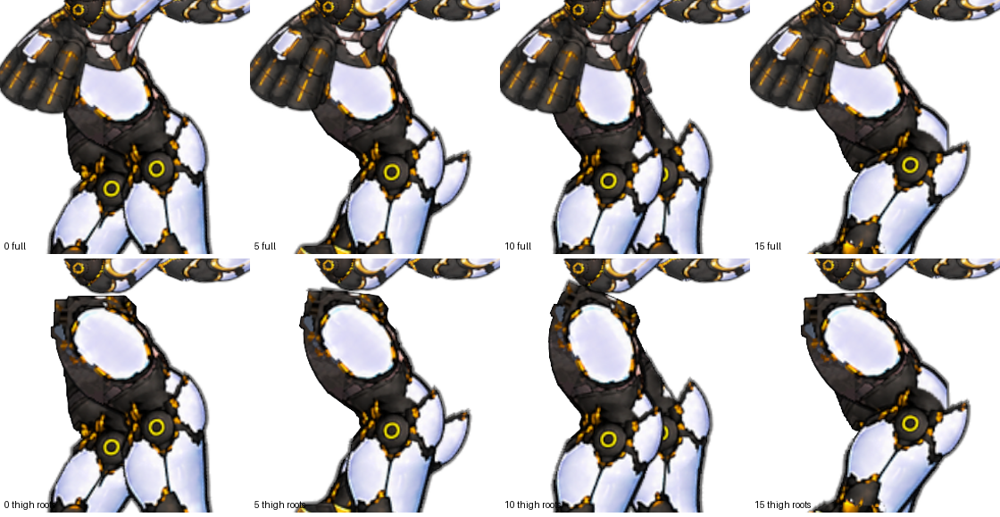
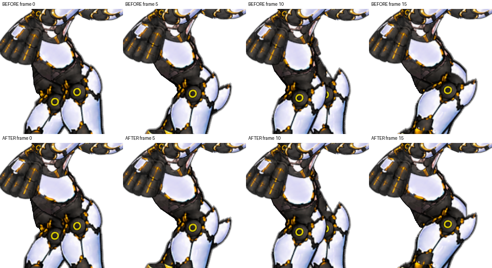
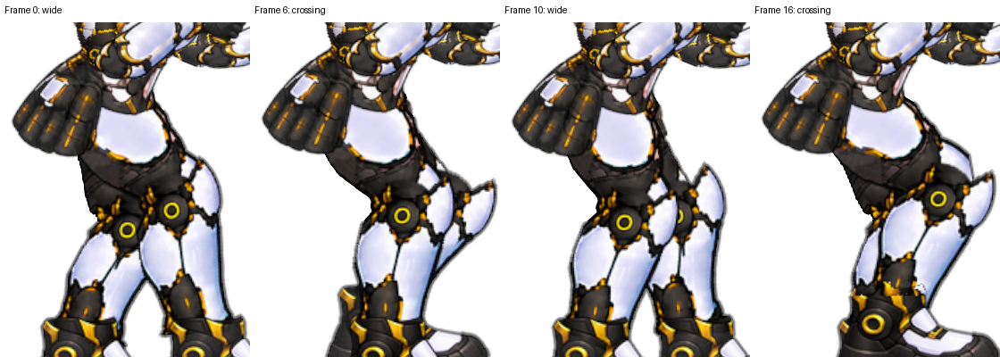

# 골반–허벅지 연결 검토

현재 승인 상태를 바꾸지 않고, 로컬 백업 후 검토했다. 외부 저장소에 업로드하지 않았다.

## 백업

`Exports/Backups/RightWalk-before-pelvis-review-20261011-223942.zip`

`Assets/RightWalkPrototype` 전체와 폴더 meta를 포함한 1,024개 파일, 약119.1MiB. ZIP 검사와 각 파일 SHA-256 대조 완료. 문서 작성 직전 기존 파일들의 SHA-256을 다시 비교해 아트/코드 변경이 없음을 확인한다. 골반 검토 뒤 추가한 이 문서와 새 검토 이미지는 백업 이후의 자료다.

## 확인한 내용

- 앞선 검토에서 20프레임의 완성 화면을 확인했다. 이번에는 0/5/10/15 프레임에서 완성 화면과 Torso/Hip Clothing/Pelvis Underlay를 숨긴 화면을 비교했다. 원래 파츠 표시와 하체 프레임, 골반 위치는 모두 복구했다.
- 별도 몸통·골반 파츠를 숨겨도 하체 Sprite에 흰 허리 장갑과 골반 그림 일부가 남아 있었다. 따라서 아래 비교 이미지의 하단은 '순수 다리만'이 아니라 별도 레이어를 숨긴 결과다. 파츠 이름 Legs와 실제 픽셀 범위가 다르다.
- 하체 재생성 기준 코드/좌표(`bake_walk_v32.py`, `baked-walk-v32.json`)에서는 near hip=(253,250+drop), far hip=(251,250+drop)이다. 양쪽 시작점의 수평 간격은2px이고 높이는 같다. 현재v72 시트는 이 궤적을 이어받은 후 픽셀 윤곽을 수정한 버전이다. 이 수치는 Unity 개별 다리 Transform의 실시간 좌표가 아니라 베이크용 관절 좌표다.
- 골반이 허벅지와 분리되어 떠 있는 큰 틈은 확인하지 못했다. 다만 다리가 엇갈릴 때 골반 아래 윤곽이 좁아지고, 두 허벅지가 거의 같은 축에서 시작하는 인상이 있다.
- 몸통과 무릎 장갑 모두 앞면이 일부 보인다. 상체만 3/4이고 다리는 완전 측면이라고 단정할 근거는 부족하다.

## 해석과 다음 순서

상체 디자인 교체가 우선이라고 판단하지 않는다. 서로 겹친 그림의 범위를 확인하지 않고 허벅지 시작점이나 골반 폭만 바꾸면 중복 그림·패임·절단선이 다시 생길 수 있다.

1. 현재 하체 시트와 별도 골반 레이어에 각각 어떤 허리/골반 픽셀이 들어 있는지 마스크로 표시해 확인한다.
2. 골반 아래로 이어지는 양 허벅지의 보이는 시작 부위를 구분한다. 2px의 베이크 피벗 간격은 점검 대상이지 즉시 오류라고 단정할 값은 아니다. 스타일/투영에 맞는 위치인지 완성 모습으로 판단한다.
3. 위치 보정이 필요하면 신발 위치·보폭·종아리 길이·승인된 허벅지 윤곽을 보존하며 작은 시험 버전을 만든다. 고정 골반 덩어리로 움직이는 허벅지를 덮는 실패를 반복하지 않는다.
4. 여러 자세에서 검토한 뒤에도 시점 차이가 남을 때 원화 디자인 변경 여부를 판단한다.

최초 검토 이후 아래의 되돌릴 수 있는 표시 변형 시험을 추가했다.

## 실제 레이어 확인에 따른 정정과 시험 결과

Hip Clothing-v43은 주로 장비 파츠이고 Torso-v42도 상체 장비 영역이다. 흰 허리와 골반 대부분은 Legs-v72에 포함되어 있다. 별도 레이어를 숨겼는데 허리가 남는다는 사실만으로 중복 그림이라고 판단해서는 안 된다. 동일한 흰 허리가 두 번 그려진다는 근거는 확인하지 못했다.

RightFacingPelvisPreview 컴포넌트로 하체 시트의 x=252 중심, y=235~315 부근만 최대 3px 좌우로 펼치는 표시 변형 시험을 적용했다. 원본 PNG, 베이크 관절 좌표, 보행 속도, 신발 위치는 수정하지 않았다. 이는 관절 재배치 또는 새 측면 원화가 아니라 골반 아래가 좁게 모이는 인상을 줄이는 작은 시각 보정이다. 신체 시점 문제를 완전히 해결했다고 판단하지 않는다.

Unity 카메라로 전/후 각각 20프레임을 캡처하고 전체 프레임과 0/5/10/15 확대 화면을 검토했다. 변형 자체의 주요 차이는 프레임0 기준 1000px 캡처의 x433~582/y446~562였다. 무릎 아래는 변형량0과3에서 같은 픽셀 결과다. 기존 SpriteRenderer와 MeshRenderer 비교에서는 아래쪽에 프레임당 0~4개의 RGB 차이8 초과 픽셀이 있었고 최대14/255였다. 이는 표시 방식 변경의 미세한 샘플링 차이이며 픽셀 단위로 완전히 동일하다고 주장하지 않는다. 컴파일 오류와 Unity 오류 로그는 없었다.

되돌리기: Twenty Frame Sprite Walker의 RightFacingPelvisPreview 체크를 끈다. 원본 SpriteRenderer 표시가 복구된다. 컴포넌트를 켜고 Spread Pixels를0으로 두면 변형 없는 메쉬 비교가 된다. Builder는 현재 시험값3으로 재생성한다.

## 왼팔 수정 후 최종 연결 검토

수평/위45도/아래45도 × 보행20프레임 = 60자세를 Unity 카메라로 다시 캡처했다. 베이크 발목 좌표상 수평 간격이 큰 대표 자세0/10(83.33px), 교차 자세6/16(0px)을 확대해 비교하고 나머지 프레임도 확인했다. 발목 수치는 원래 베이크 좌표이며 최신 신발의 시각 윤곽을 그대로 측정한 값은 아니다.

골반–허벅지 사이의 큰 흰 틈, 연결부의 분리, 명확한 겹침 역전은 이번 화면 검토에서 발견하지 못했다. 다리 교차에서 골반 아래가 좁아지는 인상과 약간의 시점 차이는 남지만, 상체 원화를 교체할 근거로 삼지는 않는다. 현재 디자인과 3px 표시 보정을 유지한다. 미세한 과거 허벅지 윤곽 문제까지 모두 사라졌다는 뜻은 아니다.

60자세의 팔 IK 도달 불가0회, 최대 손 접점 오차1.49e-8월드 단위였다. 이는 에디터에서 프레임/골반/조준을 직접 갱신한 검증이며 실시간 장시간 재생 검사와 구분한다. 검사 후 원래 다리 프레임과 골반 위치를 복구하고 조준은 수평으로 돌렸다.

